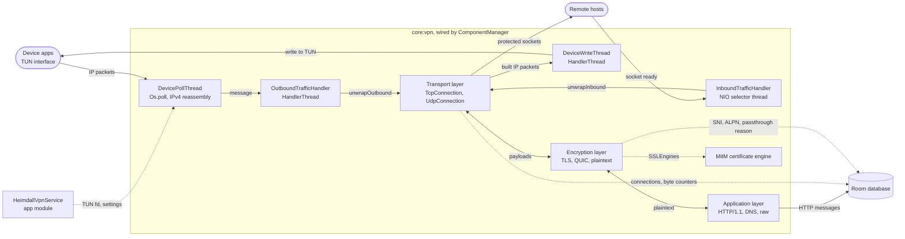
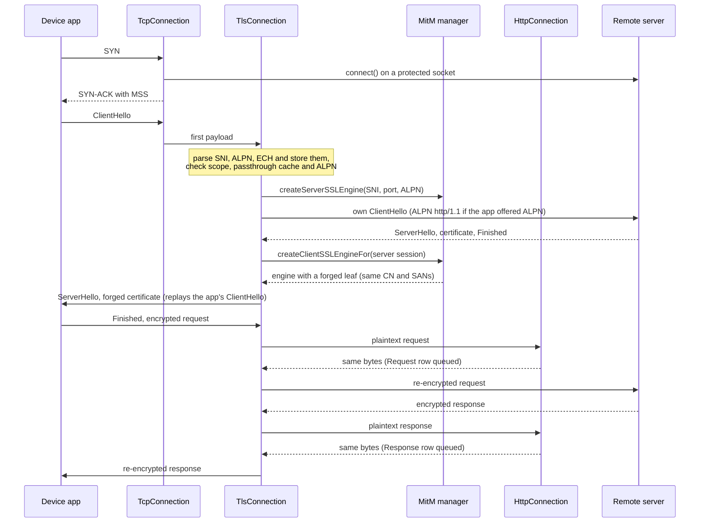
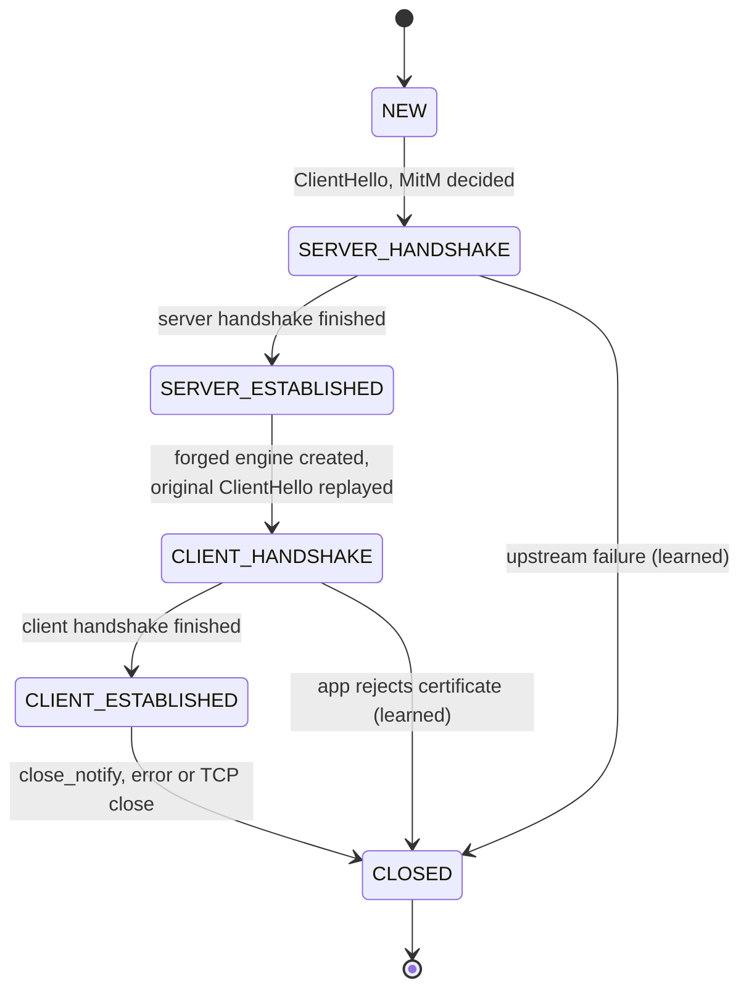

# core:vpn

A local VPN-based traffic interception engine for Android. It reads every IP packet the device routes into a TUN interface, proxies TCP connections and UDP datagrams to their real destinations over protected sockets, optionally decrypts TLS with a man-in-the-middle (MitM), and persists sessions, connections, HTTP requests and responses to the Room database.

Diagrams of this module live in [`docs/diagrams/`](../../docs/diagrams/README.md): a component architecture, sequence diagrams of an intercepted HTTPS connection, the classification of a new flow, and two BPMN processes. The most important ones are also inlined below.

---

## Table of Contents

- [Overview](#overview)
- [Package Structure](#package-structure)
- [Architecture](#architecture)
- [VPN Session Lifecycle](#vpn-session-lifecycle)
- [Packet Lifecycle](#packet-lifecycle)
- [Component Reference](#component-reference)
  - [ComponentManager](#componentmanager)
  - [Thread Layer](#thread-layer)
  - [Transport Layer](#transport-layer)
  - [Encryption Layer](#encryption-layer)
  - [Application Layer](#application-layer)
  - [Inet Layer](#inet-layer)
  - [Caches](#caches)
  - [MitM Infrastructure](#mitm-infrastructure)
  - [Database Connector](#database-connector)
- [How a New Flow Is Handled](#how-a-new-flow-is-handled)
- [TLS MitM Deep Dive](#tls-mitm-deep-dive)
- [Host Blocking](#host-blocking)
- [QUIC](#quic)
- [Threading Model](#threading-model)
- [Configuration](#configuration)
- [Limitations](#limitations)
- [Tests](#tests)
- [Key Dependencies](#key-dependencies)

---

## Overview

`HeimdallVpnService` (in `app`) establishes the TUN interface and hands its file descriptor to a `ComponentManager`, which owns everything in this module. From then on:

- Every TCP connection an app opens is terminated locally. Heimdall answers the app's TCP handshake itself and opens its own socket to the real server, so it is a transparent TCP proxy rather than a packet forwarder.
- Every UDP datagram is relayed through a `DatagramChannel`.
- On top of each transport connection sits an **encryption layer** (TLS, QUIC or plaintext) and an **application layer** (HTTP/1.1, DNS or raw). These see every payload in both directions, record what they can, and pass the bytes on.
- With MitM enabled, a TLS connection is split into two TLS sessions, one with the app and one with the server, and the HTTP/1.1 traffic between them is recorded in plaintext.

Without MitM the module still records every connection with its app, hostname, tracker label, byte counts, SNI and ALPN.

---

## Package Structure

```
core/vpn/src/main/java/de/tomcory/heimdall/core/vpn/
│
├── components/
│   ├── ComponentManager.kt         Creates and wires threads, caches, MitM state; VPN_MTU
│   ├── DevicePollThread.kt         Reads raw IP packets from the TUN interface
│   ├── IpV4Reassembler.kt          Reassembles fragmented IPv4 datagrams from the device
│   ├── OutboundTrafficHandler.kt   Dispatches device packets to transport-layer connections
│   ├── InboundTrafficHandler.kt    NIO selector loop for the outward-facing sockets
│   ├── DeviceWriteThread.kt        Writes packets back to the TUN interface
│   ├── DatabaseConnector.kt        Interface for all persistence operations
│   └── RoomDatabaseConnector.kt    Room implementation
│
├── cache/
│   └── ConnectionCache.kt          Active connections by (remote address, protocol, ports)
│
├── rules/
│   ├── HostMatcher.kt              Domain-suffix and address matching, shared with MitmScope
│   └── BlockList.kt                Hosts whose connections are dropped; block reasons
│
├── metadata/
│   ├── DnsCache.kt                 TTL-aware IP → hostname map filled from DNS answers
│   └── TlsPassthroughCache.kt      Per-session (app, host) pairs that must not be MitM'd
│
├── connection/
│   ├── transportLayer/
│   │   ├── TransportLayerConnection.kt   Base class, factory, state enum, byte counters
│   │   ├── TcpConnection.kt              TCP proxy: handshake, ordering, flow control, close
│   │   └── UdpConnection.kt              Datagram relay with idle reaping
│   ├── encryptionLayer/
│   │   ├── EncryptionLayerConnection.kt  Protocol detection, MitM decision helpers
│   │   ├── TlsConnection.kt              Dual-SSLEngine MitM, record reassembly, passthrough
│   │   ├── QuicConnection.kt             Passive Initial inspection, optional HTTP/3 block
│   │   ├── PlaintextConnection.kt        Passthrough for unencrypted traffic
│   │   └── ClientHelloParser.kt          SNI / ALPN / ECH parser shared by TLS and QUIC
│   ├── appLayer/
│   │   ├── AppLayerConnection.kt         Protocol detection and factory
│   │   ├── HttpConnection.kt             HTTP/1.1 message reassembly and persistence
│   │   ├── ChunkedBodyTracker.kt         Finds the end of chunked bodies, decodes them
│   │   ├── DnsConnection.kt              DNS over UDP: fills the DNS cache
│   │   ├── DnsStreamConnection.kt        DNS over TCP and decrypted DNS over TLS
│   │   └── RawConnection.kt              Passthrough for everything else
│   └── inetLayer/
│       ├── IpPacketBuilder.kt            Builds the IP packets sent back to the device
│       ├── IpV4PacketBuilder.kt / IpV6PacketBuilder.kt
│       └── IcmpUnreachableBuilder.kt     ICMP port unreachable for blocked QUIC flows
│
├── mitm/
│   ├── Authority.kt                      CA identity, keystore location and password
│   ├── CertificateHelper.kt              BouncyCastle root and leaf certificate generation
│   ├── KeyStoreHelper.kt                 PKCS12 keystore lifecycle, PEM / Magisk export
│   ├── SSLEngineSource.kt                SSLEngine factory, per-host SSLContext cache
│   ├── CertificateSniffingMitmManager.kt Creates the two engines of a MitM'd connection
│   ├── SubjectAlternativeNameHolder.kt   Copies SANs from the upstream certificate
│   ├── MergeTrustManager.kt              Trusts the Heimdall CA and the system CAs
│   ├── InsecureTrustManager.kt           Accepts any upstream certificate (opt-in)
│   ├── Alpn.kt                           ALPN on SSLEngine via reflection (API 29+)
│   ├── MitmScope.kt                      Which apps and hosts may be intercepted
│   └── Exceptions.kt
│
└── quic/
    ├── QuicInitialInspector.kt           Collects the ClientHello from Initial packets
    ├── QuicInitialPacket.kt              Header parsing and Initial packet decryption
    ├── QuicInitialKeys.kt                Initial secrets for QUIC v1 and v2
    ├── QuicVarInt.kt                     Variable-length integers
    └── QuicPolicy.kt                     PASSTHROUGH or BLOCK
```

---

## Architecture



Each connection is a stack of three objects. Every layer has the same four entry points:

| Method | Direction | Meaning |
|---|---|---|
| `unwrapOutbound(payload)` | device → internet, upwards | Strip this layer's framing, pass the payload to the layer above |
| `wrapOutbound(payload)` | device → internet, downwards | Add this layer's framing, pass down towards the socket |
| `unwrapInbound(...)` | internet → device, upwards | Same, for data read from the socket |
| `wrapInbound(payload)` | internet → device, downwards | Add framing, pass down towards the TUN interface |

A payload always travels up to the application layer and back down, even when no layer changes it. The application layer never alters the stream; it only records.

---

## VPN Session Lifecycle

Start and stop requests are serialised by `VpnServiceLifecycle` (`app/service`), a small state machine with the states `IDLE`, `STARTING`, `RUNNING` and `STOPPING`:

- A START while the VPN is starting or running is a no-op. One that arrives during a shutdown is dropped, since the service is about to stop itself.
- A STOP while the VPN is still starting is remembered and carried out as soon as the start has finished. A STOP without a running VPN only stops the service again.
- A failed start releases whatever it had set up and returns to `IDLE`.

Start, in `HeimdallVpnService.onStartCommand` and `launchServiceComponents`:

1. The service becomes a foreground service and calls `VpnService.prepare()`. If the user has not consented, the start is aborted; consent has to be given from the UI.
2. Preferences are resolved into plain values for this module: `doMitm`, `MitmScope`, `QuicPolicy`, the HTTP body limit, "learn passthrough" and "trust all upstream certificates".
3. The database is opened before the interface exists, so that a destructive migration does not run while the tunnel is already up.
4. The TUN interface is established with the configured address, route and DNS server and an MTU of `VPN_MTU` (1500). Heimdall itself is always excluded; with MitM on, Chrome is excluded as well.
5. `ComponentManager` is constructed. Its constructor loads or generates the CA (`CertificateSniffingMitmManager`), opens the selector and the interrupter pipe, warms up pcap4j, builds the tracker trie, persists the `Session` row (or reuses the id passed by the UI), and starts the threads in order: `DeviceWriteThread`, then `InboundTrafficHandler` and `OutboundTrafficHandler`, then `DevicePollThread`.
6. Two periodic jobs start: the idle sweep every 30 s and the byte-counter flush every second.

Stop, in `ComponentManager.stopComponents` (runs at most once):

1. Cancel the periodic jobs.
2. Close the write end of the interrupter pipe, which makes `DevicePollThread`'s `poll()` report a hang-up, and join the thread.
3. Quit the two handler threads, interrupt the selector thread, and join all three (2 s timeout each).
4. Close the pipe's read end and the TUN streams.
5. Flush the remaining byte counters, close every cached connection, then close the selector, which is what releases the sockets' descriptors.
6. Write the session's end time.

---

## Packet Lifecycle

### Outbound (device → internet)

```
TUN fd
  │
  ▼
DevicePollThread
  │  Os.poll() on the TUN fd and the interrupter pipe
  │  Drops anything that is not TCP or UDP, broadcasts, length mismatches
  │  IPv4 fragments are held in IpV4Reassembler until the datagram is complete
  ▼  Handler message (what = 6 TCP / 17 UDP)
OutboundTrafficHandler
  │  TransportLayerConnection.getInstance(): ConnectionCache lookup or new connection
  ▼
TcpConnection / UdpConnection .unwrapOutbound()
  │  TCP: ACK bookkeeping, ordering, window check, then the payload goes up
  ▼
EncryptionLayerConnection          [created on the first payload]
  │  TlsConnection / QuicConnection / PlaintextConnection
  ▼
AppLayerConnection                 [created on the first decoded payload]
  │  HttpConnection / DnsConnection / DnsStreamConnection / RawConnection
  │  records, then calls encryptionLayer.wrapOutbound(payload)
  ▼  back down through encryption → transport
SocketChannel.write() / DatagramChannel.write()   →   remote host
```

### Inbound (internet → device)

```
remote host   →   SocketChannel / DatagramChannel
  │
  ▼
InboundTrafficHandler (selector.select())
  │  the SelectionKey's attachment is the TransportLayerConnection
  ▼
TcpConnection / UdpConnection .unwrapInbound()
  │  TCP: OP_CONNECT → finishConnect, SYN-ACK to the device
  │       OP_WRITE   → drain the queue of data for the remote host
  │       OP_READ    → read, unless too much is still waiting for the device
  ▼
encryption layer → application layer → encryption layer .wrapInbound()
  ▼
TcpConnection.wrapInbound()   queued, sent as far as the device's receive window allows
UdpConnection.wrapInbound()   one datagram per payload
  ▼  Handler message
DeviceWriteThread   →   TUN fd   →   app
```

---

## Component Reference

### ComponentManager

**`components/ComponentManager.kt`**

Instantiated once per VPN session by `HeimdallVpnService` and passed to every thread and connection.

| Property | Purpose |
|---|---|
| `sessionId: Long` | Room id of the current `Session` |
| `doMitm` | Master switch for TLS interception |
| `mitmScope: MitmScope` | Apps and hosts that may be intercepted |
| `blockList: BlockList` | Hosts whose connections are dropped instead of forwarded |
| `learnPassthrough` | Whether MitM failures are learned per (app, host) |
| `pinningCloseWindowMs` | How soon after the handshake a data-less close counts as pinning (default 3 s) |
| `quicPolicy: QuicPolicy` | `PASSTHROUGH` or `BLOCK`; always `PASSTHROUGH` without MitM |
| `refuseDnsOverTlsTo` | The VPN's DNS server if TCP port 853 to it is to be refused, else null |
| `maxHttpBodySize` | Bytes of each HTTP body that are kept |
| `trustAllUpstreamCertificates` | Skip validation of the real server's certificate |
| `selector` / `selectorMonitor` | The shared NIO selector and the monitor that guards registration |
| `dnsCache`, `tlsPassthroughCache` | Per-session caches |
| `mitmManager` | `CertificateSniffingMitmManager`; always created, also without MitM |
| `appFinder` | Resolves a socket's owner to an app id and package |
| `databaseConnector` | All persistence |
| `maxPacketSize` | Size of per-connection I/O buffers and the largest TCP segment sent to the device (16 413) |

`labelConnection(host)` looks a hostname up in the tracker trie built from the bundled hosts list (`res/raw/adhosts.txt`).

### Thread Layer

**`DevicePollThread`** reads one packet per `read()` into a `VPN_MTU`-sized buffer, validates it, parses it with pcap4j and posts it to `OutboundTrafficHandler`. An exception while parsing drops the packet, not the thread.

**`OutboundTrafficHandler`** (`HandlerThread`) handles every packet from the device on one thread. Exceptions are caught per packet: a failure in a connection closes that connection only. Nothing on this thread may block, which is why connection setup, database writes and writes to slow sockets are all moved off it.

**`InboundTrafficHandler`** (plain thread) runs `selector.select()` and calls `unwrapInbound()` on the connection attached to each ready key, again with per-connection exception isolation. It passes through `selectorMonitor` before each `select()` so that a thread registering a channel is not locked out, but processes the keys outside the monitor.

**`DeviceWriteThread`** (`HandlerThread`) is the only writer to the TUN fd. It accepts pcap4j `IpPacket`s and raw `ByteArray`s (ICMP errors). The message codes `WRITE_TCP`, `WRITE_UDP`, `WRITE_STRAY` and `WRITE_ICMP` are informational.

### Transport Layer

#### TransportLayerConnection

```kotlin
enum class TransportLayerState { CONNECTING, CONNECTED, HALF_CLOSED, CLOSING, CLOSED, ABORTED }
```

`getInstance()` returns the cached connection for a packet or creates one. The hostname comes from `DnsCache` (reverse lookup of the destination address). For TCP segments of unknown flows:

- an RST is ignored,
- a FIN or ACK is answered with an RST built by `TcpConnection.buildResetFor()` (RFC 9293 rules),
- a SYN to port 853 of the VPN's DNS server is refused if `refuseDnsOverTlsTo` is set, so that Private DNS in opportunistic mode falls back to plain DNS that Heimdall can read,
- anything else creates a `TcpConnection`.

The base class also holds:

- `remoteHost`, which the encryption layer can correct through `refineRemoteHost(sni, echOffered)` (the tracker label is re-evaluated and both are persisted) and the HTTP layer through `fillMissingRemoteHost(hostHeader)`;
- the byte counters, which are only added up in memory and written by `flushByteCounters()` in batches;
- `inboundProcessingDeferred/Finished` and the outbound counterparts, with which an encryption layer that works asynchronously tells the transport layer how many bytes it is still holding. TCP flow control counts these.

`closeHard()` closes the channel, aborts the client side (TCP RST) unless told otherwise, and removes the connection from the cache. `closeSoft()` does the same without removing it.

#### TcpConnection

A TCP endpoint towards the device and a `SocketChannel` towards the remote host.

- **Setup** runs off the packet thread on a dispatcher limited to 8 threads: resolve the app (`AppFinder`), create the database row, `protect()` and connect the socket, register `OP_CONNECT`. The SYN-ACK is sent when the socket has connected. It carries the MSS the device announced. If connecting fails, the device gets an RST that its `connect()` reports as "connection refused".
- **Receiving from the device.** Segments are accepted in sequence order. Retransmissions are dropped and re-acknowledged, partial overlaps are trimmed, and segments ahead of a gap wait in a reorder buffer bounded by the advertised window.
- **Sending to the remote host.** What the channel does not take immediately is queued and written on `OP_WRITE`. The window advertised to the device shrinks as this backlog approaches `OUT_BACKLOG_LIMIT` (256 KB), so a slow server slows the app instead of stalling the VPN.
- **Sending to the device.** Data is queued and sent only as far as the device's receive window allows (`sendLock` keeps segments in sequence order across threads). Reading from the socket pauses when more than `SEND_BACKLOG_HIGH` is waiting and resumes below `SEND_BACKLOG_LOW`. No window scaling is negotiated and nothing is retransmitted: a TUN interface does not lose packets.
- **Closing.** A FIN from the device half-closes the connection (`HALF_CLOSED`: the socket's output is shut down, the reply is still relayed) if the encryption layer supports it; a MitM'd TLS connection does not, and is closed fully. When the remote host closes first, only reading stops, the device can keep sending, and the encryption layer decides when the FIN is delivered so that it never overtakes data. The connection is `CLOSED` once the device's FIN has been received and our FIN acknowledged. Read errors and resets from the remote host become an RST to the device, not a FIN.
- **Sweep.** `sweepStaleConnections()` (every 30 s) aborts connections that sit in `HALF_CLOSED` or `CLOSING` for more than two minutes without progress and probes the device's window when data has waited 10 s.

Initial sequence numbers are drawn from `SecureRandom` over the full 32-bit space.

#### UdpConnection

A connected `DatagramChannel` with a 1 MB receive buffer. Each datagram is written once; one the channel does not take is dropped. Connections to port 53 close after the first answer. All others are reaped by `sweepIdleConnections()` after five minutes without traffic, since UDP has no close of its own.

### Encryption Layer

`EncryptionLayerConnection.getInstance()` decides on the first outbound payload:

| Result | Rule |
|---|---|
| `PlaintextConnection` | Remote port 53 (DNS is never taken for TLS), or nothing else matches, or the first data seen is inbound |
| `TlsConnection` | TCP, byte 0 is `0x16` and byte 5 is `0x01` (a ClientHello) |
| `QuicConnection` | UDP, at least 1200 bytes, long header with fixed bit, non-zero version, packet type Initial (v1 and v2 numbering) |

The base class provides `interceptionHost()` (SNI, else DNS-derived name, else IP address), `interceptionSkipReason()` / `wouldIntercept()` (the one place the scope and passthrough decision is made, used by both TLS and the QUIC block rule), and `persistSecurity()`, which writes `securityProtocol`, `sni`, `alpn` and `echOffered` to the connection row in call order.

`TlsConnection` and `QuicConnection` are described in their own sections below.

### Application Layer

`AppLayerConnection.getInstance()` decides on the first payload that reaches it:

| Result | Rule |
|---|---|
| `DnsConnection` | UDP to port 53 |
| `DnsStreamConnection` | TCP to port 53, or TCP to port 853 that is being decrypted |
| `HttpConnection` | The first 11 bytes contain an HTTP method or `HTTP` |
| `RawConnection` | Anything else, including every connection first seen from the inbound side |

**HttpConnection** parses HTTP/1.x in both directions with independent reassembly state:

- Bodies are delimited by `Content-Length`, by chunked encoding (`ChunkedBodyTracker` follows the declared chunk sizes and hands over the decoded data), or, for responses with neither, by connection close.
- Interim `1xx` responses are skipped. `101` and a successful `CONNECT` switch the connection to opaque forwarding. `204`, `304` and responses to `HEAD` have no body.
- Only the first `maxHttpBodySize` bytes of a body are kept (default 256 KB, at most 1 MB); the real length and a `contentTruncated` flag are stored with it. Bodies are stored as bytes.
- A header block that does not end within 64 KB turns that direction opaque.
- Requests and responses are paired in wire order through a queue of `CompletableDeferred` request ids, so pipelining and slow database writes cannot mismatch them. Each connection's writes run one at a time under a fair mutex.
- A connection without a hostname takes it from the first request's `Host` header.

**DnsConnection / DnsStreamConnection** forward everything unchanged and put the A and AAAA answers into `DnsCache` under the name the query asked for, with the record's TTL. The stream variant handles the two-byte length prefix and messages split across segments.

### Inet Layer

`IpPacketBuilder` (IPv4 / IPv6) holds a connection's addresses and builds the packets sent to the device, with source and destination swapped. `buildStray()` builds a reply to a packet that belongs to no connection. `IcmpUnreachableBuilder` builds an ICMP port unreachable error byte by byte, quoting the datagram it answers.

### Caches

| Cache | Key | Notes |
|---|---|---|
| `ConnectionCache` | `(remoteAddress, protocol, localPort, remotePort)` | Process-wide `ConcurrentHashMap`. Removing a connection flushes its byte counters |
| `DnsCache` | IP address | LRU, 1000 entries, per-record TTL (default 60 s). An expired record is removed on lookup and not returned |
| `TlsPassthroughCache` | `(appId, hostname)` | Four bounded LRU maps: passthrough reason, suspect counts, pairs that have carried decrypted data, pairs whose HTTP/3 was blocked. Lives for one VPN session |

### MitM Infrastructure

**Authority** names the CA (`heimdallmitm`, issuer `CN=Heimdall, O=TU Berlin, OU=SNET`) and its files under `filesDir/keystore`. The keystore password is random per install and stored next to the keystore in `heimdallmitm.pwd`.

**KeyStoreHelper** loads `heimdallmitm.p12` or creates it. A keystore that cannot be read, has no certificate, or whose CA certificate is not currently valid is regenerated; a missing `.pem` export alone is simply re-exported. It also exports the CA for installation: `exportCaFiles()` (PEM plus `<subject_hash_old>.0`), `exportRootCertificate()` (a `.crt` for the user store) and `createMagiskModuleWithCertificate()`.

**CertificateHelper** generates certificates with BouncyCastle:

| | Root CA | Forged leaf |
|---|---|---|
| Key | RSA 2048 | RSA 2048 |
| Validity | now − 1 year to now + 100 years | now − 1 year to now + 1 day |
| Extensions | `BasicConstraints CA:true` (critical), `KeyUsage keyCertSign, cRLSign, digitalSignature` (critical), `ExtendedKeyUsage serverAuth, clientAuth` | `BasicConstraints CA:false`, the upstream certificate's SANs |
| Signature | `SHA512WithRSAEncryption` (`SHA256` on 32-bit) | same, signed by the CA key |

**SSLEngineSource** builds the client-side `SSLContext` (`TLSv1.3`, falling back to `TLSv1`) with `MergeTrustManager` (Heimdall CA plus system CAs) or, if the user opted in, `InsecureTrustManager`. Server-facing engines verify the hostname (`endpointIdentificationAlgorithm = "HTTPS"`). Forged server contexts are cached per common name in a Guava cache that expires five minutes after last access.

**CertificateSniffingMitmManager** creates the two engines of a connection: `createServerSSLEngine(sni, port, alpn)` for the real server, and `createClientSSLEngineFor(serverSession, alpn)`, which reads the common name and SANs from the server's certificate and returns a server-mode engine presenting a forged certificate for the same names.

**MitmScope** decides whether an app and host may be intercepted: an optional app whitelist, an app blacklist, and a host whitelist or blacklist matched by domain suffix. The app module builds it from the preferences (`MitmScopeResolver`).

**Alpn** sets and reads ALPN on an `SSLEngine` by reflection. It is available from API 29; below that, engines negotiate no ALPN.

### Database Connector

`RoomDatabaseConnector` implements `DatabaseConnector`.

| Method | Writes |
|---|---|
| `persistSession` / `updateSession` | `Session` start and end |
| `persistTransportLayerConnection` | A `Connection` row. Not `suspend`: the id is assigned in memory and returned at once, the insert runs in the background, and every later call for that id waits for it |
| `deleteTransportLayerConnection` | Removes a connection that never came up |
| `updateConnectionBytesOut` / `In` | Adds a delta to the byte counters |
| `updateConnectionSecurity` | `securityProtocol`, `sni`, `alpn`, `echOffered` |
| `updateConnectionHost` | A corrected hostname and tracker label |
| `markConnectionBlocked` | `blocked = true` and `blockReason` (`host_rule` or `quic_policy`) |
| `updateConnectionPassthroughReason` | Why a TLS connection was not decrypted |
| `persistHttpRequest` / `persistHttpResponse` | `Request` and `Response` rows |

DNS connections (remote port 53) get id 0 and no row.

---

## How a New Flow Is Handled

A TLS connection is decrypted only if all of the following hold when its ClientHello arrives:

1. MitM is enabled for the session.
2. The app and the host are inside the user's MitM scope. Otherwise the reason is `OUT_OF_SCOPE`.
3. No passthrough has been learned for this app and host in this session. Otherwise the reason is the learned `PassthroughReason`.
4. The client offers no ALPN, or offers `http/1.1` among its protocols. Otherwise the reason is `ALPN_UNSUPPORTED` (gRPC and other clients that require HTTP/2).

A connection that fails a check is forwarded record by record, and the reason is stored in `Connection.passthroughReason`.

---

## TLS MitM Deep Dive



`TlsConnection` holds two `SSLEngine`s. The names follow the role Heimdall plays towards each peer's counterpart:

```
Device app ── clientSSLEngine (server mode) ── TlsConnection ── serverSSLEngine (client mode) ── server
              forged certificate                                validates the real certificate
```

**State machine**



A connection that is passed through never leaves `NEW`: with `doMitm = false` every record goes straight to the application layer and back.

**Confinement.** All state is mutated on `connectionScope`, a dispatcher limited to one task at a time (`Dispatchers.IO.limitedParallelism(1)`). `unwrapOutbound` and `unwrapInbound` only enqueue work, so the two handler threads never touch the engines or buffers. The transport layer is told how many bytes are queued, which keeps TCP flow control honest across the asynchronous hop.

**Record reassembly.** `prepareRecords()` turns the TCP stream into whole TLS records: it reassembles records split across segments, splits segments that carry several records, and stashes fragments shorter than the five-byte header.

**Handshake ordering.** The server-facing handshake runs first, because the forged certificate is modelled on the real one. Records the app sends in the meantime (a ClientHello spread over several records, 0-RTT data) are buffered, at most 16, and replayed once the client-facing handshake starts. Delegated tasks of the engines run inline so that no record of a multi-record flight is refused.

**ALPN.** If the app offered ALPN, the server is offered `http/1.1` only, and the app is answered with what the server selected. A server that insists on HTTP/2 fails the handshake, which is learned as `UPSTREAM_HANDSHAKE_FAILED`.

**Passthrough learning** (`TlsPassthroughCache`, switchable through `learnPassthrough`). The current connection cannot be saved, since its ClientHello has been consumed, but later connections of the same app to the same host are passed through:

| `PassthroughReason` | Trigger | Effect |
|---|---|---|
| `CLIENT_HANDSHAKE_ERROR` | The client-facing engine throws on data from the app during the handshake, typically a certificate alert | Immediate |
| `CLIENT_CLOSED_DURING_HANDSHAKE` | The app closes or resets TCP during the client-facing handshake | Immediate |
| `UPSTREAM_HANDSHAKE_FAILED` | Heimdall's handshake with the server fails, e.g. its certificate does not verify | Immediate, and stored on the connection |
| `CLOSED_WITHOUT_DATA` | The app completes the handshake and closes without sending data within `pinningCloseWindowMs`, or at any time if the connection is a TLS fallback forced by the QUIC block | After two hits; ignored once the pair has carried decrypted data |

**Closing.** A `close_notify` from the server ends the client-facing session with Heimdall's own `close_notify` and leaves the TCP close to the transport layer, queued behind any data still being processed. A `close_notify` or TCP close from the app closes both sessions. An alert the app sends before the client-facing engine exists is plaintext and simply ends the TLS side without a reset.

---

## Host Blocking

`BlockList` holds hostnames, matched as domain suffixes by `HostMatcher`, and IP addresses, matched exactly. `TransportLayerConnection.applyBlockList()` checks a connection's name and address against it at two points:

1. **When the connection is created**, with the name the DNS cache holds for the remote address, or the address itself. `TcpConnection.setUp()` then closes the connection before any socket is opened, which answers the device's SYN with a reset. `UdpConnection` opens no channel, stays in the connection cache, drops every datagram and answers the first three with ICMP port unreachable.
2. **When the name is learned later**, in `refineRemoteHost()`: the SNI of a TLS ClientHello, of a QUIC Initial, or an HTTP Host header. The connection is marked and torn down (`dropBlocked()`); `TlsConnection` returns before it forwards the ClientHello.

Both record the block through `markConnectionBlocked(id, BlockReason.HOST_RULE)`. In case 2 the upstream TCP handshake has already happened, since the socket is connected before the ClientHello arrives; no payload is forwarded. A plain-HTTP connection that is only named by its Host header is closed after its first request has been sent. `HostBlockingTest` covers both points for TCP, TLS, UDP and QUIC.

---

## QUIC

QUIC is never decrypted beyond its first packets. `QuicConnection` does two things:

1. **Passive inspection.** `QuicInitialInspector` derives the Initial keys from the client's Destination Connection ID (QUIC v1 and v2), decrypts the client's Initial packets, collects CRYPTO frames across up to four datagrams, and parses the ClientHello. SNI, ALPN and the ECH flag are stored on the connection and the hostname is refined, also when MitM is off. Datagrams are forwarded first, so inspection never delays traffic.
2. **Block policy** (only with MitM on and `QuicPolicy.BLOCK`). The first datagrams are held back until the inspector has a verdict. If the flow offers HTTP/3 (`h3` or `h3-*`) and the TLS MitM would intercept the same app and host, the flow is blocked: the socket is released, the connection is marked `blocked`, every datagram is dropped, and the first three are answered with an ICMP port unreachable error so that the app falls back to TLS over TCP at once. Flows whose ClientHello cannot be read are forwarded.

While a block list is set, the first datagrams are held back as well, whatever the policy, so that a flow whose server name is on the list is dropped before anything is forwarded.

The default policy is `PASSTHROUGH`.

---

## Threading Model

| Thread | Type | Blocks on |
|---|---|---|
| `DevicePollThread` | `Thread` | `Os.poll()` |
| `OutboundTrafficHandler` | `HandlerThread` | Message queue |
| `InboundTrafficHandler` | `Thread` | `Selector.select()` |
| `DeviceWriteThread` | `HandlerThread` | Message queue |

All four run at `THREAD_PRIORITY_FOREGROUND`. The two plain threads set it at the top of `run()`, because `Process.setThreadPriority(int)` applies to the calling thread.

Coroutines:

| Scope | Dispatcher | Work |
|---|---|---|
| `ComponentManager.componentScope` | `Dispatchers.IO` | Idle sweep (30 s), byte-counter flush (1 s) |
| `TcpConnection.setupScope` | `IO.limitedParallelism(8)` | App lookup, `protect()`, connect, selector registration |
| `TlsConnection.connectionScope` | `IO.limitedParallelism(1)` per connection | All TLS record processing and handshakes |
| `HttpConnection.persistScope` | `Dispatchers.IO`, one write at a time per connection | Request and response rows |
| `RoomDatabaseConnector.insertScope` | `Dispatchers.IO` | Connection inserts |

Locks:

- `ComponentManager.selectorMonitor` guards channel registration against a `select()` in progress.
- `TcpConnection`: `sendLock` (everything sent to the device and its sequence numbers), `writeLock` (the queue for the remote host), `closeLock` (the closing handshake, which both handler threads drive), `interestLock` (the selection key's interest set).
- `DnsCache` and `TlsPassthroughCache` use a `ReentrantReadWriteLock`.

---

## Configuration

Everything is passed to `ComponentManager` at construction; nothing changes while the VPN runs.

| Parameter | Default | Preference (resolved in `app`) |
|---|---|---|
| `doMitm` | `false` | `mitmEnable` |
| `mitmScope` | `MitmScope.ALL` | MitM monitoring scope for apps and hosts (`MitmScopeResolver`) |
| `blockList` | `BlockList.NONE` | `vpnBlockedHosts`, plus the `SESSION_BLOCK_HOSTS_EXTRA` intent extra for one session (`BlockListResolver`) |
| `learnPassthrough` | `true` | `mitmAppLayerPassthrough` |
| `trustAllUpstreamCertificates` | `false` | `mitmTrustAllUpstreamCerts` |
| `quicPolicy` | `PASSTHROUGH` | `mitmQuicPolicy`, or the `QUIC_POLICY_EXTRA` intent extra for one session (`QuicPolicyResolver`) |
| `maxHttpBodySize` | 256 KB (max 1 MB) | `mitmHttpBodyLimitKb` (`HttpBodyLimitResolver`) |
| `refuseDnsOverTlsTo` | `null` | The VPN's DNS server unless Private DNS is in strict mode |
| `pinningCloseWindowMs` | 3000 | none |
| `existingSessionId` | `-1` (create one) | `SESSION_ID_EXTRA` intent extra |
| `keyStoreDir` | required | `filesDir/keystore` |
| `maxPacketSize` | 16 413 | none |

Constants worth knowing:

| Constant | Value |
|---|---|
| `VPN_MTU` | 1500 |
| `TcpConnection.OUT_BACKLOG_LIMIT` | 256 KB |
| `TcpConnection.SEND_BACKLOG_HIGH` / `LOW` | 131 070 / 32 768 bytes |
| `TcpConnection.MAX_WINDOW` | 65 535 (no window scaling) |
| Half-closed and closing timeouts | 2 min each |
| `UdpConnection.DEFAULT_IDLE_TIMEOUT_MS` | 5 min |
| `IpV4Reassembler` | 5 s timeout, 64 pending datagrams |
| `QuicInitialInspector` | 4 datagrams, 16 KB of handshake data |
| `TlsPassthroughCache` | 1000 entries per map, 2 hits for `CLOSED_WITHOUT_DATA` |

---

## Limitations

- Only HTTP/1.1 is parsed. HTTP/2 is avoided by ALPN negotiation or passed through; HTTP/3 is passed through or blocked.
- QUIC payloads are never decrypted.
- Only TCP and UDP are carried. Other protocols, including ICMP from apps, are dropped at the TUN interface.
- IPv6 packets are parsed and built, but the service only routes IPv4 into the tunnel by default, and IPv6 fragments are not reassembled.
- Apps that pin certificates are detected and passed through from their second connection on; the first one fails.
- Passthrough knowledge is per VPN session and is not persisted.

---

## Tests

JVM unit tests live in `core/vpn/src/test`. `integration/` drives whole connection stacks with the fixtures in `integration/support` (a fake TLS server and client, a recording `DatabaseConnector`, a selector pump) and covers TCP setup, half-close, receive window, backpressure, the TLS MitM flow, passthrough learning, the QUIC policies and DNS. The other packages hold tests per class. Run them with:

```bash
./gradlew :core:vpn:test
```

For tests against a rooted emulator with real traffic, see `scripts/emulator-traffic.sh` and `scripts/stress/`.

---

## Key Dependencies

| Library | Version | Used for |
|---|---|---|
| pcap4j (`pcap4j-core`, `pcap4j-packetfactory-static`) | 1.7.6 | Parsing and building IP, TCP, UDP and DNS packets |
| BouncyCastle (`bcpkix-jdk15on`) | 1.69 | X.509 certificate generation, PEM export |
| Guava | 28.2-android | Cache of forged `SSLContext`s |
| Room KTX | 2.7.1 | Persistence |
| Timber | 4.7.1 | Logging |
| `core:database`, `core:util` | internal | Entities and DAOs; `AppFinder`, `Trie` |

TLS itself is the platform's JSSE `SSLEngine` (Conscrypt on Android).
